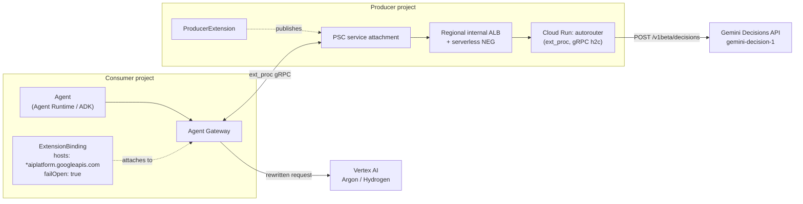
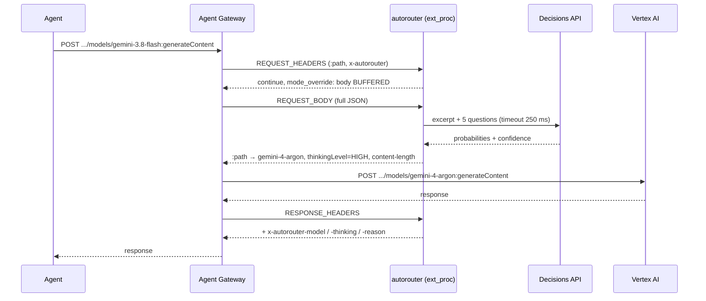

# Agent Gateway Auto-Router

**Send each agent's LLM call to the right Gemini model and thinking level, automatically, at the gateway.**


> **Status: preview.** The code, tests, and deploy scripts are complete, and the 31 tests pass locally.
> It has **not** yet been run against a live Agent Gateway or the live Decisions API. The extension-bindings
> docs don't say whether a third-party extension can rewrite request bodies, so deploy in **shadow mode** first
> and read [§7 Limitations and open items](#7-limitations-and-open-items).

## At a glance

| | |
|---|---|
| **What it is** | An `ext_proc` callout attached to Agent Gateway with an **ExtensionBinding** on Agent → LLM egress |
| **Classifier** | The [Gemini Decisions API](https://aistudio.google.com/docs/decisions-api) (`gemini-decision-1`): one call, five questions, calibrated probabilities |
| **Chooses** | Model (**Gemini 4 Argon** vs **Hydrogen** fast tier) and thinking level (`LOW` / `MEDIUM` / `HIGH`) |
| **How** | Rewrites the model in `:path` and `generationConfig.thinkingConfig.thinkingLevel` before the call reaches Vertex AI |
| **When unsure** | Passes the request through **unchanged**, including on errors and timeouts |
| **Latency budget** | ≤ 300 ms total; 250 ms hard timeout on the classifier call |
| **Runs on** | Cloud Run (gRPC over HTTP/2) behind an internal ALB and Private Service Connect |
| **Rollout** | `SHADOW_MODE=true` by default: logs decisions, changes nothing |

## Quick start

```bash
# 1. Test locally (no network needed)
python3 -m venv .venv && . .venv/bin/activate && pip install -r requirements-dev.txt && python -m pytest -q

# 2. Calibrate thresholds on your own prompts (needs a Gemini API key)
GEMINI_API_KEY=... python -m eval.run_eval --sweep

# 3. Deploy, in shadow mode
vi deploy/env.sh && source deploy/env.sh
./deploy/01-bootstrap.sh && ./deploy/02-deploy-cloud-run.sh && ./deploy/03-lb-and-psc.sh
./deploy/04-producer-extension.sh && ./deploy/05-extension-binding.sh

# 4. Read the decision logs, then go live
SHADOW_MODE=false ./deploy/02-deploy-cloud-run.sh
```

Full walkthrough: [§4 Getting started](#4-getting-started).

---

The auto-router is a Service Extensions callout that runs inside Agent Gateway's **Agent → LLM** egress path.
For every Vertex AI `generateContent` request, it asks the **Gemini Decisions API** how demanding the request is.
It then rewrites the request in flight:

| Rewrites | Choices |
|---|---|
| Model | **Gemini 4 Argon** (frontier, `gemini-4-argon`) or **Gemini Hydrogen** (fast tier; `gemini-3.8-flash` stands in until Hydrogen ships) |
| Thinking level | `LOW`, `MEDIUM`, or `HIGH` |

Agents don't change their code. Platform teams set the routing policy in one place, under the same
governance plane that already handles identity, IAP, and Model Armor.

---

## Contents

1. [Concept](#1-concept)
2. [High-level design](#2-high-level-design)
3. [Routing policy](#3-routing-policy)
4. [Getting started](#4-getting-started)
5. [Configuration reference](#5-configuration-reference)
6. [Operating it](#6-operating-it)
7. [Limitations and open items](#7-limitations-and-open-items)
8. [Repository layout](#8-repository-layout)
9. [License and attribution](#9-license-and-attribution)
10. [References](#10-references)

---

## 1. Concept

### The problem

Agents usually hardcode one model and one thinking setting. That forces a bad trade-off:

* **Pin the frontier model everywhere** and you pay frontier prices and latency for "thanks!", reformatting, lookups, and routine tool steps.
* **Pin the fast model everywhere** and you lose quality on the requests that matter: debugging, multi-step plans, legal and financial analysis.
* **Let every agent team build its own router** and you get N inconsistent policies, no central visibility, and no way to roll out a new model (such as Hydrogen) across the fleet in one change.

### The idea

Make model selection a **gateway policy**, not application code. Agent Gateway already sees every agent → LLM call.
An extension attached there can:

1. Look at the request (system instruction, latest user turn, tool count, size).
2. Ask a purpose-built classifier, the **Decisions API**, a few calibrated yes/no questions.
3. Rewrite the model and thinking level before the call reaches Vertex AI.

### Why the Decisions API

The Decisions API (`gemini-decision-1`) returns **calibrated probabilities**, not generated text, so the router can
branch on numbers instead of parsing prose. All questions are scored in **one forward pass** over shared input,
so asking five questions costs about the same latency as asking one. It also bills input tokens only.
Its own docs list model routing as a primary use case.

### Design principles

* **Do no harm.** When the router is unsure, errors, or times out, the request goes through **unchanged**.
* **Bounded latency.** The classifier call has a hard 250 ms timeout, inside a 300 ms total budget.
* **Minimal data out.** The classifier sees a truncated, redacted excerpt, never the full conversation.
* **Observable.** Every decision is a structured log line and carries response headers the agent can read.
* **Safe rollout.** Shadow mode logs what the router *would* do without touching traffic.

---

## 2. High-level design

### Components



| Component | Owner | Purpose |
|---|---|---|
| **Cloud Run `autorouter`** | Producer | The `ext_proc` gRPC server (this repo). Plaintext gRPC over HTTP/2, as Agent Gateway producers require. |
| **Internal ALB + serverless NEG** | Producer | Puts Cloud Run behind a forwarding rule so it can be published over PSC. |
| **PSC service attachment** | Producer | Private connectivity from the consumer's gateway to the producer. |
| **ProducerExtension** | Producer | Packages the callout and its connectivity as one managed extension. |
| **ExtensionBinding** | Consumer | Attaches the extension to a specific Agent Gateway, scoped to the Vertex AI hosts. |
| **Decisions API** | Google | The classifier. Called with an API key kept in Secret Manager. |

Producer and consumer can be the same project.

### Request lifecycle



### What gets rewritten

Both tiers are served from the same `aiplatform.googleapis.com` host, and the model is part of the URL path.
So routing is a **path and body rewrite**. The backend never changes and route-cache clearing isn't needed.

```diff
- POST /v1/projects/P/locations/global/publishers/google/models/gemini-3.8-flash:generateContent
+ POST /v1/projects/P/locations/global/publishers/google/models/gemini-4-argon:generateContent

  "generationConfig": {
    "thinkingConfig": {
-     "thinkingBudget": 1024
+     "thinkingLevel": "HIGH"
    }
  }
```

`thinkingBudget` is removed because Gemini 3+ models reject requests that set both. Every other field the agent
sent (temperature, tools, safety settings, `includeThoughts`) is preserved.

### What the classifier sees

A compact, redacted excerpt, capped at `EXCERPT_MAX_CHARS` (default 6,000):

```text
[Request metadata]
conversation_turns: 3
tool_declarations: 2
media_parts: 0
estimated_input_tokens: 812
latest_turn: tool_result

[System instruction, truncated]
You are a finance agent...

[Latest user message, truncated]
Email [EMAIL], key [SECRET] ...
```

Emails, API keys and OAuth tokens, JWTs, SSNs, card-like numbers, and phone numbers are masked before anything
leaves the project. Long text keeps its head and tail.

---

## 3. Routing policy

Rules are evaluated in order:

| # | Condition | Outcome |
|---|---|---|
| 1 | Path isn't `:generateContent` or `:streamGenerateContent` | Untouched; body not inspected |
| 2 | Header `x-autorouter: off` | Untouched; body not inspected |
| 3 | Requested model not in `ROUTABLE_MODELS` (default: the two tier models) | Untouched |
| 4 | Estimated input ≥ `LONG_CONTEXT_TOKENS` (32k), or ≥ `MANY_TOOLS` (8) function declarations | **Argon** (deterministic) |
| 5 | Decisions API: max P(any Argon criterion) ≥ `ARGON_THRESHOLD` (0.65) | **Argon** |
| 6 | Decisions API: max P(any Argon criterion) ≤ `HYDROGEN_THRESHOLD` (0.35) | **Hydrogen** |
| 7 | Probability in between (uncertain) | **Pass through unchanged** |
| 8 | Decisions API error, safety block, or timeout | **Pass through unchanged** (rule 4 still routes to Argon) |

**Argon criteria** (yes/no questions, scored in one call):

| Key | Asks whether the request needs… |
|---|---|
| `multistep_reasoning` | Multi-step reasoning, planning, math, or careful deduction |
| `code_work` | Non-trivial code, debugging, root-causing, or refactoring |
| `high_stakes` | Legal, financial, security, or compliance analysis where subtle errors cause harm |
| `agentic_tool_heavy` | Orchestrating several tools or reasoning over complex tool results |

**Thinking level** comes from a `score` question (Little / Some / Deep → `LOW` / `MEDIUM` / `HIGH`).
It's applied only when its confidence is ≥ `THINKING_MIN_CONFIDENCE` (0.5). It's clamped to the levels the chosen
model supports, and ties round up. Otherwise the agent's own thinking config is kept.
`MINIMAL` is never emitted, because Gemini 4 models don't support it.

---

## 4. Getting started

### 4.1 Prerequisites

* A Google Cloud project with billing, and permission to create Cloud Run, Compute (subnets, LB, PSC),
  Secret Manager, and IAM resources.
* Access to the **Agent Gateway extension bindings preview**, and an existing Agent Gateway whose agents call
  Vertex AI `generateContent`.
* A **Gemini API key** with access to the Decisions API (from Google AI Studio).
* Access to `gemini-4-argon` and your fast-tier model on Vertex AI.
* Local tools: `gcloud` (with `beta` components), Python 3.11+, and `perl`. macOS and Cloud Shell both have perl.
* Org policy that allows a Cloud Run service with `allUsers` invoker. The service is still only reachable through
  the internal LB because of `--ingress=internal-and-cloud-load-balancing`.

### 4.2 Run and test locally

```bash
git clone <this repo> agw-autorouter && cd agw-autorouter
python3 -m venv .venv && . .venv/bin/activate
pip install -r requirements-dev.txt

python -m pytest -q                                      # 31 tests, no network needed
GEMINI_API_KEY=... PORT=8080 python -m autorouter.server  # plaintext gRPC on :8080
```

### 4.3 Calibrate on your traffic (recommended before deploying)

```bash
GEMINI_API_KEY=... python -m eval.run_eval --sweep
```

This prints, for each prompt in `eval/prompts.jsonl`, the expected vs. routed tier, the thinking level, and
P(argon). It also reports:

* **Routing accuracy** on the requests the router acted on.
* **Coverage**: the share of requests it acted on rather than passing through.
* **Thinking accuracy**, and **p50/p95 classifier latency** against the 250 ms timeout.
* With `--sweep`, accuracy and coverage for a grid of threshold pairs.

Add a few dozen real, anonymized prompts from your agents to the JSONL file. The format is
`{"id", "prompt", "system"?, "tools"?, "expect_model", "expect_thinking"}`. Pick thresholds that give
acceptable accuracy at the coverage you want.

### 4.4 Deploy

All settings live in `deploy/env.sh`. Edit it once, then run the scripts in order:

```bash
vi deploy/env.sh            # projects, region, network ranges, gateway name, model IDs
source deploy/env.sh
```

| Step | Script | Creates |
|---|---|---|
| 1 | `./deploy/01-bootstrap.sh` | Enables APIs, creates the Artifact Registry repo and service account, and stores the Decisions API key in Secret Manager (prompts for the key). |
| 2 | `./deploy/02-deploy-cloud-run.sh` | Builds the image with Cloud Build, then deploys Cloud Run with `--use-http2`, port 8080, `min-instances=1`, the secret mounted as `GEMINI_API_KEY`, and **`SHADOW_MODE=true`**. |
| 3 | `./deploy/03-lb-and-psc.sh` | LB, proxy-only, and PSC NAT subnets; a serverless NEG; an `HTTP2` backend service; the URL map, HTTP proxy, and internal forwarding rule; and a PSC service attachment (`ACCEPT_MANUAL`, with the consumer project allow-listed). |
| 4 | `./deploy/04-producer-extension.sh` | `gcloud beta service-extensions producer-extensions create`, pointing at the service attachment, with the phase from `PRODUCER_PHASE`. |
| 5 | `./deploy/05-extension-binding.sh` | Renders `extension-binding.yaml.tmpl` and imports the ExtensionBinding on your Agent Gateway, matching the Vertex hosts in `VERTEX_HOSTS`, with `failOpen: true`. |

The rendered binding looks like this:

```yaml
name: autorouter-llm-egress
target:
  resources:
  - "projects/CONSUMER/locations/us-central1/agentGateways/my-agent-gateway"
matchConditions:
- to:
    destination:
      hosts:
      - exact: "aiplatform.googleapis.com"
      - exact: "us-central1-aiplatform.googleapis.com"
producerExtension: "projects/PRODUCER/locations/us-central1/producerExtensions/autorouter"
failOpen: true
```

> Add every Vertex host your agents call (for example `europe-west4-aiplatform.googleapis.com`) to `VERTEX_HOSTS`
> before step 5.

### 4.5 Verify

1. **The callout is up.**
   ```bash
   gcloud logging read 'resource.type="cloud_run_revision" AND jsonPayload.event="startup"' --limit=1
   ```
2. **Traffic reaches it.** Trigger any agent that calls Vertex through the gateway, then:
   ```bash
   gcloud logging read 'jsonPayload.component="autorouter" AND jsonPayload.event="decision"' \
     --limit=20 --format='table(jsonPayload.requested_model, jsonPayload.routed_model,
       jsonPayload.thinking_level, jsonPayload.reason, jsonPayload.total_ms)'
   ```
3. **The agent sees the outcome.** Responses carry `x-autorouter-model`, `x-autorouter-thinking`, and
   `x-autorouter-reason`. In shadow mode the reason is prefixed `shadow:`.

If no decision lines appear, check the binding's host list against the hosts your agents call, and that the PSC
connection is accepted:
`gcloud compute service-attachments describe $SERVICE_ATTACHMENT --region=$REGION`.

### 4.6 Go live

Shadow mode logs decisions but never changes a request. Leave it on for a few days and watch:

* `reason` mix: how often `uncertain` and `classifier_error` appear (that's your coverage).
* `signals.classifier_ms` p95, which should sit comfortably under `DECISIONS_TIMEOUT_MS`.
* Whether `argon:*` decisions match what you'd have chosen by hand.

Then turn routing on:

```bash
SHADOW_MODE=false ./deploy/02-deploy-cloud-run.sh
```

To limit blast radius, first set `ROUTABLE_MODELS` to a model ID that only a canary agent uses, then widen it.

### 4.7 Opt out, roll back, tear down

* **Per request:** the agent sends `x-autorouter: off`.
* **Globally, instantly:** redeploy with `SHADOW_MODE=true`, or delete the binding:
  `gcloud beta service-extensions extension-bindings delete $BINDING_NAME --location=$GATEWAY_LOCATION`.
* **Everything:** `./deploy/teardown.sh` removes all created resources except the secret and the service account.

---

## 5. Configuration reference

Set as Cloud Run environment variables. The defaults below are in `autorouter/config.py`.

| Variable | Default | Meaning |
|---|---|---|
| `ARGON_MODEL` | `gemini-4-argon` | Strong-tier Vertex model ID |
| `HYDROGEN_MODEL` | `gemini-3.8-flash` | Fast-tier model ID. Set it to the Hydrogen ID at launch. |
| `ROUTABLE_MODELS` | *(both tiers)* | Comma list. Only requests naming one of these models are re-routed. |
| `ARGON_THINKING_LEVELS` / `HYDROGEN_THINKING_LEVELS` | `LOW,MEDIUM,HIGH` | Levels each model accepts; decisions are clamped to these |
| `GEMINI_API_KEY` | from Secret Manager | Decisions API key. If unset, every request passes through. |
| `DECISIONS_MODEL` | `gemini-decision-1` | Decisions model |
| `DECISIONS_ENDPOINT` | `…/v1beta/decisions` | Decisions REST endpoint |
| `DECISIONS_TIMEOUT_MS` | `250` | Hard timeout on the classifier call |
| `ARGON_THRESHOLD` | `0.65` | Max criterion probability at or above which a request goes to Argon |
| `HYDROGEN_THRESHOLD` | `0.35` | Max criterion probability at or below which a request goes to Hydrogen |
| `THINKING_MIN_CONFIDENCE` | `0.5` | Minimum confidence to set a thinking level |
| `LONG_CONTEXT_TOKENS` | `32000` | Estimated input size that forces Argon |
| `MANY_TOOLS` | `8` | Function-declaration count that forces Argon |
| `EXCERPT_MAX_CHARS` | `6000` | Size cap on what the classifier sees |
| `REDACT` | `true` | Mask PII and secrets in the excerpt |
| `THINKING_LEVEL_CASE` | `upper` | `HIGH` vs `high` in the rewritten body |
| `SHADOW_MODE` | `false` in code, `true` in `deploy/env.sh` | Log decisions without mutating requests |
| `SERVER_THREADS` | `64` | gRPC worker threads; each in-flight request holds one |
| `PORT` | `8080` | Plaintext gRPC listen port |

The classifier's question wording lives in `autorouter/classifier.py` (`ARGON_CRITERIA`, `THINKING_QUESTION`).
Changing it is the most effective tuning lever after the thresholds. Re-run the eval after every change.

---

## 6. Operating it

**Decision log** (one JSON line per routed request, `jsonPayload` in Cloud Logging):

```json
{"severity":"INFO","component":"autorouter","event":"decision","shadow":false,
 "requested_model":"gemini-3.8-flash","routed_model":"gemini-4-argon","thinking_level":"HIGH",
 "reason":"argon:code_work",
 "signals":{"criteria":{"multistep_reasoning":0.41,"code_work":0.93,"high_stakes":0.04,"agentic_tool_heavy":0.12},
            "p_argon":0.93,"thinking_score":1.71,"thinking_confidence":0.68,"classifier_ms":118.4,
            "target_model":"gemini-4-argon"},
 "streaming":false,"est_input_tokens":812,"tool_declarations":2,"total_ms":121.0}
```

**`reason` values:**

| Reason | Meaning |
|---|---|
| `argon:<criterion>` | Routed to Argon because of that criterion |
| `hydrogen:simple` | Routed to Hydrogen |
| `long_context` / `many_tools` | Argon by deterministic rule |
| `uncertain` | Passed through: the probability was between the thresholds |
| `classifier_error` | Passed through: the Decisions API timed out, errored, or blocked on safety |
| `model_not_routable` | Passed through: the request named a model outside `ROUTABLE_MODELS` |
| `body_not_buffered` | Passed through: the gateway streamed the body, so the path couldn't be changed |
| `bad_json` | Passed through: the body wasn't valid JSON |

Useful log-based metrics: the routed-model ratio (cost), the `uncertain` + `classifier_error` rate (coverage),
and `total_ms` p95 (added latency).

**Scaling:** each in-flight request holds a gRPC stream and a thread. Cloud Run concurrency (64) and
`SERVER_THREADS` (64) should match. Scale out with instances, not threads. `min-instances=1` avoids cold starts
blowing the latency budget.

---

## 7. Limitations and open items

Confirm these with the Agent Gateway team before turning off shadow mode:

1. **Body access by phase.** The extension-bindings docs only show `--phase authz`. Confirm which phase delivers
   `REQUEST_BODY` on Agent → LLM egress and applies body and `:path` mutations; set `PRODUCER_PHASE` to match.
2. **`failOpen` behavior** for 2P extensions isn't documented. The design assumes the original request flows if
   the callout is unreachable.
3. **Ordering with Model Armor** on the same path: should screening see the routed request or the original?
4. **Load balancer frontend.** The scripts use a plaintext HTTP/2 frontend on port 80. Switch to an HTTPS target
   proxy if the gateway's PSC client requires TLS.
5. **Thinking-level casing** on Vertex REST: toggle with `THINKING_LEVEL_CASE` if Vertex rejects `HIGH`.
6. **Hydrogen.** No public model ID exists yet. Set `HYDROGEN_MODEL` and `HYDROGEN_THINKING_LEVELS` when it ships.

Known limits of this version:

* Vertex **native `generateContent`** only. OpenAI-compatible `/chat/completions` traffic passes through untouched.
* Requires a **buffered** request body. Streamed bodies are logged and passed through.
* Token counts are estimated (characters ÷ 4), not exact.
* **Data path:** the Decisions API is only on the Gemini Developer API (API key), not on Vertex AI. Only the
  redacted excerpt leaves your project; the full request still goes to Vertex. Review this against your data
  residency requirements. `autorouter/classifier.py` implements a small `Classifier` interface, so a
  Vertex-hosted classifier can be swapped in.

---

## 8. Repository layout

```
autorouter/
  server.py       ext_proc phases: headers → body (classify + rewrite) → response headers
  policy.py       routing rules and thresholds
  classifier.py   Decisions API REST client and question definitions
  vertex.py       path parsing and rewrite, feature extraction, redaction, thinkingConfig mutation
  config.py       environment-driven configuration
extproc/service/  CalloutServer SDK, vendored from GoogleCloudPlatform/service-extensions (Apache-2.0)
tests/            pytest suite, including a real gRPC round trip
eval/             labeled prompts and run_eval.py (accuracy, coverage, latency, threshold sweep)
deploy/           env.sh, 01–05 gcloud scripts, binding template, teardown.sh
Dockerfile        python:3.13-slim, prebuilt Envoy protos from xds-protos, runs as non-root
```

---

## 9. License and attribution

`extproc/service/` is vendored from [GoogleCloudPlatform/service-extensions](https://github.com/GoogleCloudPlatform/service-extensions)
under the Apache License 2.0 (see `extproc/LICENSE`). Each vendored file keeps its original license header.

---

## 10. References

* [Extension bindings for Agent Gateway](https://docs.cloud.google.com/gemini-enterprise-agent-platform/govern/gateways/extension-bindings-overview)
* [Agent Gateway overview](https://docs.cloud.google.com/gemini-enterprise-agent-platform/govern/gateways/agent-gateway-overview)
* [Service Extensions callout samples (Python ext_proc)](https://github.com/GoogleCloudPlatform/service-extensions/tree/main/callouts/python/extproc/example)
* [Gemini Decisions API](https://aistudio.google.com/docs/decisions-api)
* [Thinking levels on Vertex AI](https://docs.cloud.google.com/gemini-enterprise-agent-platform/models/thinking)
* [Envoy ext_proc filter](https://www.envoyproxy.io/docs/envoy/latest/configuration/http/http_filters/ext_proc_filter)
